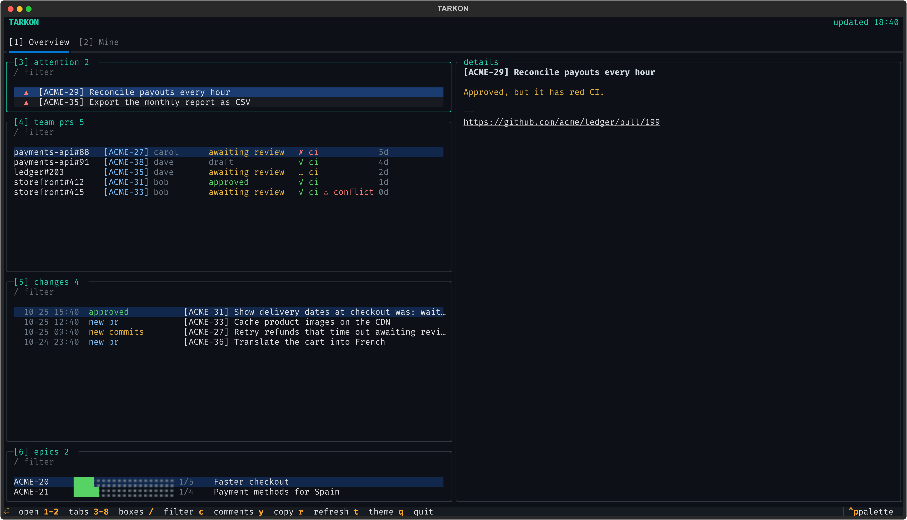
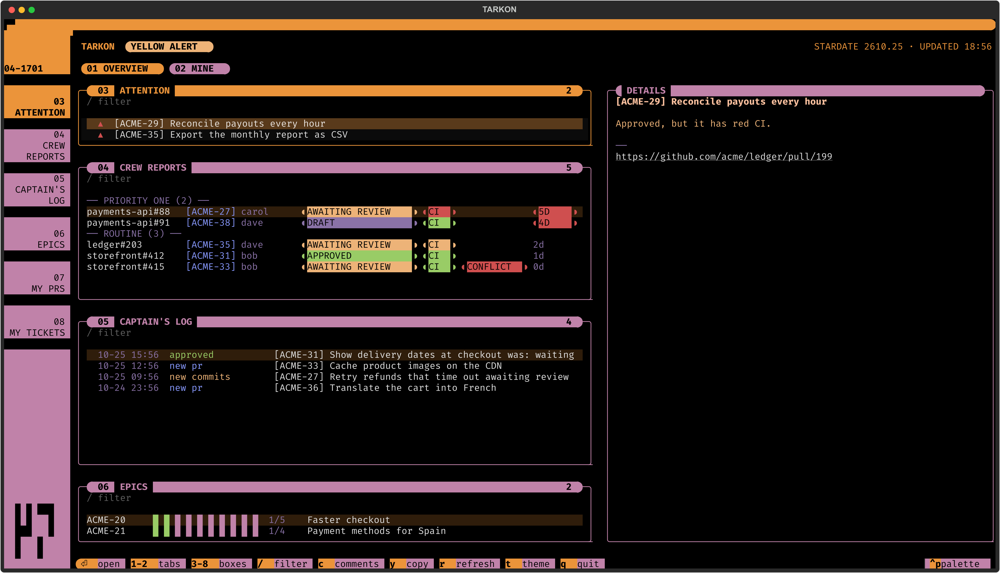
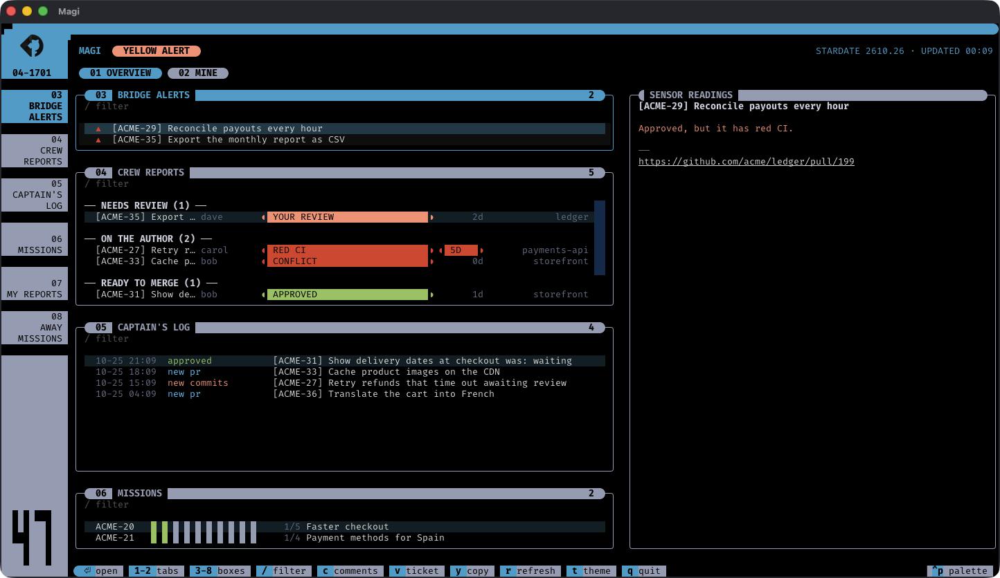
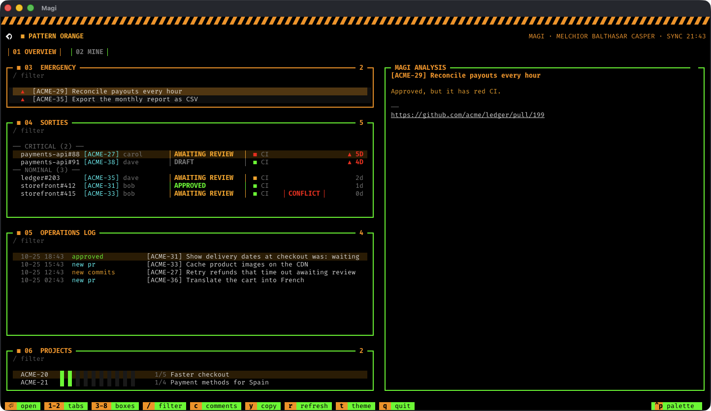
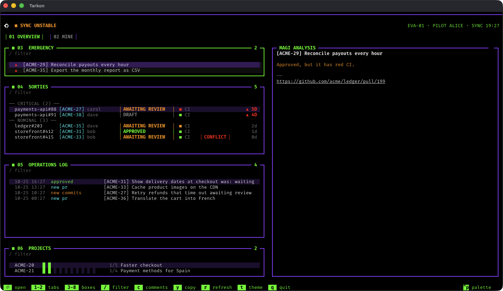
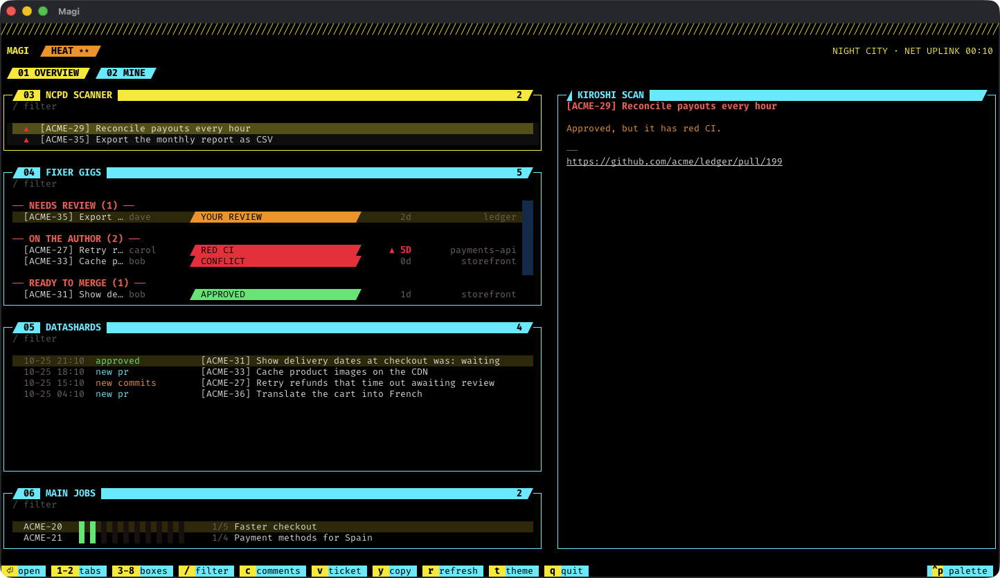

<p align="center"></p>

# Magi

Magi shows your team's board on one screen: the PRs that need you, the team's open PRs, what changed in the last 24 hours, the progress of every Jira epic in Developing or Rollout, and your own open PRs and Jira tickets. It reads GitHub through the `gh` CLI and Jira through the Atlassian `acli` CLI, and runs as a terminal app built with [Textual](https://textual.textualize.io).



## Quick start

```bash
brew install davidkang/magi/magi
brew tap atlassian/homebrew-acli && brew install acli
gh auth login
acli jira auth login --web
magi
```

The formula brings in `gh` and Python; `acli` comes from Atlassian's own tap.

The first run opens the settings panel. Fill in every field and save with `ctrl+s`.

## Requirements

| Requirement | Why |
|-------------|-----|
| macOS | Opening links and copying use `open` and `pbcopy` |
| Python 3.12 or newer | `requires-python = ">=3.12"` |
| [`gh`](https://cli.github.com), logged in | Every GitHub call is `gh api graphql` |
| [`acli`](https://developer.atlassian.com/cloud/acli/), logged in to Jira | Every Jira call is `acli jira workitem search` or `view` |
| [Homebrew](https://brew.sh) or [pipx](https://pipx.pypa.io) | Installs `magi` in its own environment |

Magi checks for `gh` and `acli` on every start and exits with the install command for any that is missing.

Python packages, installed automatically:

| Package | Version |
|---------|---------|
| `textual` | `>=8.2` |
| `textual-image` | `>=0.14` |
| `pillow` | `>=10` |
| `pytest` (extra `dev` only) | `>=8` |

## Credentials

Magi stores no tokens and reads none from the environment. It runs `gh` and `acli`, so it sees exactly what those two CLIs are logged in as. Check them with `gh auth status` and `acli jira auth status`.

### GitHub

The simplest way is the browser login, which stores the token in your system credential store:

```bash
gh auth login
```

To use a personal access token instead:

1. Create a classic token at [github.com/settings/tokens](https://github.com/settings/tokens) with the scopes `repo`, `read:org` and `gist`. These are the minimum scopes `gh auth login --with-token` accepts; `repo` is what lets Magi search PRs and read their reviews, comments, review threads and CI status in private repositories.
2. If your organization uses SAML single sign-on, authorize the token for it from the same page (**Configure SSO**).
3. Pass it to `gh` on standard input:
   ```bash
   gh auth login --with-token < token.txt
   ```

`gh` also honours a token in the `GH_TOKEN` environment variable; `gh` recommends that route for fine-grained tokens.

### Jira

Log `acli` in to your Atlassian site, either through the browser:

```bash
acli jira auth login --web
```

or with an API token:

1. Create one at [id.atlassian.com/manage-profile/security/api-tokens](https://id.atlassian.com/manage-profile/security/api-tokens) (**Create API token**).
2. Pass it to `acli` on standard input, with your site and email:
   ```bash
   acli jira auth login --site "acme.atlassian.net" --email "you@acme.com" --token < token.txt
   ```

`acli` decides which Jira site is queried and who "you" are: the **Mine** tab lists the tickets assigned to the `acli` user. The **Jira site** setting below is only used to build ticket links.

## Installation

With Homebrew, which also installs `gh`:

```bash
brew install davidkang/magi/magi
```

New releases arrive with `brew upgrade`, like any other formula.

Or with pipx, from GitHub:

```bash
pipx install --python python3.12 git+https://github.com/DavidKang/magi.git
```

Or from a clone:

```bash
git clone https://github.com/DavidKang/magi.git
cd magi
pipx install --python python3.12 .
```

For a development setup, see [Development](#development).

## Configuration

The first run, or `magi config` at any time, opens the settings panel. Every field is required; `ctrl+s` saves and `escape` cancels.

| Field | Example | Used for |
|-------|---------|----------|
| GitHub users of your team | `alice, bob, carol` | Whose open PRs make up the team's board, besides your own (commas or spaces) |
| Jira project | `ACME` | Which project's epics are shown |
| Your GitHub user | `alice` | Which PRs are yours |
| GitHub organization | `acme` | Limits every PR search to `org:<organization>` |
| Jira site | `https://acme.atlassian.net` | Ticket and epic links |

Settings are saved to `~/.config/magi/config.json`, together with the theme picked with `t`.

Epics are not configured: the board shows every epic of the project in Developing or Rollout, newest first.

## Usage

| Command | What it does |
|---------|--------------|
| `magi` | Opens the board in the terminal |
| `magi config` | Opens the settings panel |

`python -m magi` works the same as `magi`. `magi --help` prints the usage, and so does any other argument, which exits with code 2.

### Keys

| Key | Action |
|-----|--------|
| `1` / `2` | Switch to the `Overview` tab or the `Mine` tab |
| `3`-`6` | Jump to the `Overview` tab's boxes: attention, team PRs, changes, epics |
| `7`-`8` | Jump to the `Mine` tab's boxes: your open PRs, your Jira tickets not done, grouped by status |
| `j` / `k` | Move down / up |
| `enter` | Open the selected item in the browser |
| `c` | Open the selected PR's comments, reviews and code threads with their diff, or the selected ticket's description and comments (`j`/`k` move, `enter` opens it in the browser, `esc` closes) |
| `v` | Open the Jira ticket of the selected PR in a popup, fetched from Jira the first time after each refresh (`c` opens its description and comments, `enter` opens it in the browser, `esc` closes) |
| `/` | Filter the current box (`escape` clears it) |
| `y` | Copy the selected link (the key, for an epic) |
| `s` | Snooze the selected attention item or team PR until it changes (see [Snoozed](#snoozed)) |
| `S` | Bring back every snoozed item of the current box |
| `r` | Refresh (once every 30 seconds at most; it also refreshes every 5 minutes) |
| `t` | Pick a theme (see [Themes](#themes)) |
| `q` | Quit |

### Team PRs

Team PRs are grouped by whose turn it is, oldest first in each group:

| Group | When |
|-------|------|
| needs review | Nobody approved or asked for changes yet, or the author pushed after the last change request (`re-review`). PRs that ask for your review come first, as `your review` |
| on the author | Changes requested, red CI or a conflict |
| ready to merge | Approved, with no red CI or conflict |
| drafts | Drafts |

Each row starts with the PR's title, which stretches with the box up to 60 columns, then the author, what the PR is missing and its age, red after three days; the repo, without the PR number, sits at the right edge. A green CI shows nothing.

The detail of a PR says in one status line what it is missing, as its row does, when it opened and when it was last pushed, and lists its activity newest first, with a day's commits in one line. `v` opens its Jira ticket in a popup.

### Changes

The changes box keeps one row per PR: its latest change, or the latest move of a ticket only that PR names. Its detail lists the PR's commits and reviews with the moves of its ticket and what GitHub's history does not tell, such as a draft marked ready or how the PR left the board, newest first, from what the refresh already fetched.

### What is new

A change you have not seen yet puts a `●` on its rows in every box, a `N new` count in the box title and a `●` on its tab; the detail opens with the change and its time. Moving the cursor off the row marks it seen. The first start marks nothing.

### Snoozed

`s` takes the selected attention item or team PR off its box until Magi sees a change on it newer than the one it had: a push, a review, a ticket move. CI turning red or a conflict alone does not wake it. It then comes back, marked new. A snooze holds in its own box only, survives a restart, and is dropped once the item leaves the box. The box title counts the rows it hides, as `N snoozed`, and `S` brings it all back.

## Themes

Press `t` to pick a theme. Magi remembers your choice in its settings.

| Theme | Inspired by |
|-------|-------------|
| **Default** | Plain terminal colours |
| **LCARS Okuda · TNG and DS9** | Star Trek's LCARS computer screens, in the Okuda colours |
| **LCARS Picard** | The same LCARS frame, in the Picard colours |
| **NERV Magi** | Evangelion's NERV command screens |
| **NERV - EVA 01** | The NERV frame, in Unit-01's purple and green |
| **Cyberpunk · Night City** | Cyberpunk 2077's HUD |

> [!TIP]
> The LCARS themes look best with any [Nerd Font](https://www.nerdfonts.com/font-downloads) as your terminal's font, for example FiraCode Nerd Font Mono (`brew install --cask font-fira-code-nerd-font`). Without one, the round ends of their pills show as empty boxes; everything else works. The default, NERV and Cyberpunk themes need no special font.

### Alert level

The LCARS, NERV and Cyberpunk themes show how the board is doing in the header:

| | When | LCARS | NERV Magi | NERV - EVA 01 | Cyberpunk |
|---|------|-------|-----------|---------------|-----------|
| 🟢 | Nothing is waiting | CONDITION GREEN | NORMAL | SYNC STABLE | NO HEAT |
| 🟡 | A PR waits on CI or review, or a teammate's fails CI or conflicts | YELLOW ALERT | PATTERN ORANGE | SYNC UNSTABLE | HEAT ★★ |
| 🔴 | One of your PRs fails CI or conflicts | RED ALERT | PATTERN BLUE | BERSERK | HEAT ★★★★★ |

### Box names

| Box | Default | LCARS | NERV | Cyberpunk |
|-----|---------|-------|------|-----------|
| What needs you | attention | BRIDGE ALERTS | EMERGENCY | NCPD SCANNER |
| Team PRs | team prs | CREW REPORTS | SORTIES | FIXER GIGS |
| Last 24 hours | changes | CAPTAIN'S LOG | OPERATIONS LOG | DATASHARDS |
| Epics | epics | MISSIONS | PROJECTS | MAIN JOBS |
| Your PRs | my prs | MY REPORTS | MY SORTIES | MY GIGS |
| Your tickets | my tickets | AWAY MISSIONS | MY ORDERS | SIDE JOBS |
| Details | details | SENSOR READINGS | MAGI ANALYSIS | KIROSHI SCAN |

### LCARS

| LCARS Okuda | LCARS Picard |
|---|---|
|  |  |

- A **stardate** marks the last refresh, and a refresh under way reads `ENGAGING WARP DRIVE…`.
- What a PR is missing and its age are drawn as **rounded pills**.
- Team PR groups are written in capitals, and a PR open more than three days shows its age in red.

### NERV

| NERV Magi | NERV - EVA 01 |
|---|---|
|  |  |

**NERV Magi**

- Colours from [nerv-ui](https://github.com/mdrbx/nerv-ui), since the show has no official palette: black, orange text, green grid, red alert, amber warning.
- A **hazard stripe** across the top turns red on alert.
- The header shows the **MAGI's sync time**.
- Heavy-lined boxes with **outlined badges**, and the age of a PR open more than three days gets a red ▲.
- Team PR groups are written in capitals.

**NERV - EVA 01**

- The same frame in Unit-01's colours: **purple lines**, **green titles** and focus.
- A quiet purple line on top turns into the red hazard stripe when it goes **berserk**.
- You, by your GitHub user, are its **pilot**.

### Cyberpunk



- Colours picked by eye from Cyberpunk 2077's HUD, since the game has no published palette: off-red text, cyan lines, yellow focus.
- A **hatched line** across the top turns red at five stars.
- The header shows the **net uplink** time, and a refresh under way reads `JACKING IN…`.
- Square boxes with **slanted titles, tabs and badges**, and the age of a PR open more than three days gets a red ▲.

## Data locations

| Path | Content |
|------|---------|
| `~/.config/magi/config.json` | Your settings |
| `~/.local/state/magi/state.json` | Last snapshot, used to detect changes, the changes of the last 24 hours and the activity of the PRs they show; kept across upgrades |
| `~/.cache/magi/cache.json` | Last board, shown while the next refresh runs; a cache from another version is dropped |
| `~/.cache/magi/prs.json` | Comments, reviews and threads of the PRs on the board, reused until a PR changes |
| `~/.cache/magi/updated.json` | When each in-progress ticket last changed, refetched only for tickets Jira reports as changed |
| `~/.cache/magi/my-tickets.json` | Details of your own tickets, refetched only for tickets Jira reports as changed |
| `~/.cache/magi/seen.json` | The last change you saw on each PR or ticket, so new ones stay marked until you pass them |
| `~/.cache/magi/snoozed.json` | What you snoozed in each box, with the change each item had then |
| `~/.cache/magi/last-refresh` | When the last refresh started, so reopening the app or pressing `r` waits 30 seconds |

Magi used to be called Tarkon. On start, it moves any `tarkon` folder in those three places to `magi`, unless a `magi` folder is already there.

## Limits

- macOS only: opening links and copying use `open` and `pbcopy`.
- Jira statuses are mapped to columns by name: `Backlog`, `Tareas por hacer`, `En proceso`, `Developing`, `Paused`, `En revisión`, `Ready To Deploy`, `Rollout` and `Finalizado`. `Rejected / Cancelled` tickets are left out, and any other status stops the refresh with `Unmapped Jira status: <name>`.
- PR searches use GitHub's GraphQL API at 1 point each, out of 5000 points an hour: one per 6 team members, one for your review requests, and one per 6 ticket keys for open and for merged PRs, about 15 per refresh on a board of 9 epics and 200 tickets. A PR's comments, reviews and threads are fetched again only when the PR changed.

## Development

```bash
python3.12 -m venv .venv
.venv/bin/pip install -e '.[dev]'
.venv/bin/python -m pytest -q
.venv/bin/python scripts/profile_refresh.py  # one real refresh, timed per call; leaves your files alone
.venv/bin/python scripts/screenshots.py      # the screenshots in assets/screenshots/, on made-up data; needs Ghostty, a Nerd Font and Screen Recording permission
```

### Where things live

| Path | What it does |
|------|--------------|
| `magi/domain/` | The board's rules: entities, status columns, review state, what needs attention, what changed, what stays snoozed |
| `magi/application/` | One refresh: fetches through the interfaces in `ports.py` and builds the board as data |
| `magi/adapters/` | Talks to the outside: `gh`, `acli`, JSON files, data paths, the clock |
| `magi/cli.py` | Entry point: wires the adapters into the refresh and starts the app |
| `magi/tui/` | The terminal app: rows and detail text (`entries.py`), popups and settings (`screens.py`), themes (`theme.py`) |
| `magi/rows.py` | PR and ticket rows as plain data, formatted by `tui/entries.py` |

## License

MIT. See [LICENSE](LICENSE).
