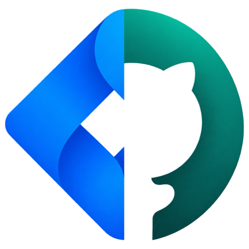

<p align="center"></p>

# Tarkon

Tarkon shows your team's board on one screen: the PRs that need you, the team's open PRs, what changed in the last 24 hours, the progress of every Jira epic in Developing or Rollout, and your own open PRs and Jira tickets. It reads GitHub through the `gh` CLI and Jira through the Atlassian `acli` CLI, and runs as a terminal app built with [Textual](https://textual.textualize.io).

## Quick start

```bash
brew install pipx gh
brew tap atlassian/homebrew-acli && brew install acli
gh auth login
acli jira auth login --web
pipx install --python python3.12 git+https://github.com/DavidKang/tarkon.git
tarkon
```

The first run opens the settings panel. Fill in every field and save with `ctrl+s`.

## Requirements

| Requirement | Why |
|-------------|-----|
| macOS | Opening links and copying use `open` and `pbcopy` |
| Python 3.12 or newer | `requires-python = ">=3.12"` |
| [`gh`](https://cli.github.com), logged in | Every GitHub call is `gh api graphql` |
| [`acli`](https://developer.atlassian.com/cloud/acli/), logged in to Jira | Every Jira call is `acli jira workitem search` or `view` |
| [pipx](https://pipx.pypa.io) (recommended) | Installs `tarkon` in its own environment |

Tarkon checks for `gh` and `acli` on every start and exits with the install command for any that is missing.

Python packages, installed automatically:

| Package | Version |
|---------|---------|
| `textual` | `>=8.2` |
| `textual-image` | `>=0.14` |
| `pillow` | `>=10` |
| `pytest` (extra `dev` only) | `>=8` |

## Credentials

Tarkon stores no tokens and reads none from the environment. It runs `gh` and `acli`, so it sees exactly what those two CLIs are logged in as. Check them with `gh auth status` and `acli jira auth status`.

### GitHub

The simplest way is the browser login, which stores the token in your system credential store:

```bash
gh auth login
```

To use a personal access token instead:

1. Create a classic token at [github.com/settings/tokens](https://github.com/settings/tokens) with the scopes `repo`, `read:org` and `gist`. These are the minimum scopes `gh auth login --with-token` accepts; `repo` is what lets Tarkon search PRs and read their reviews, comments, review threads and CI status in private repositories.
2. If your organization uses SAML single sign-on, authorize the token for it from the same page (**Configure SSO**).
3. Pass it to `gh` on standard input:
   ```bash
   gh auth login --with-token < token.txt
   ```

`gh` also honours a token in the `GH_TOKEN` environment variable; `gh` recommends that route for fine-grained tokens.

### Jira

Log `acli` in to your Atlassian site, either through the browser:

```bash
acli jira auth login --web
```

or with an API token:

1. Create one at [id.atlassian.com/manage-profile/security/api-tokens](https://id.atlassian.com/manage-profile/security/api-tokens) (**Create API token**).
2. Pass it to `acli` on standard input, with your site and email:
   ```bash
   acli jira auth login --site "acme.atlassian.net" --email "you@acme.com" --token < token.txt
   ```

`acli` decides which Jira site is queried and who "you" are: the **Mine** tab lists the tickets assigned to the `acli` user. The **Jira site** setting below is only used to build ticket links.

## Installation

With pipx, from GitHub:

```bash
pipx install --python python3.12 git+https://github.com/DavidKang/tarkon.git
```

Or from a clone:

```bash
git clone https://github.com/DavidKang/tarkon.git
cd tarkon
pipx install --python python3.12 .
```

For a development setup, see [Development](#development).

## Configuration

The first run, or `tarkon config` at any time, opens the settings panel. Every field is required; `ctrl+s` saves and `escape` cancels.

| Field | Example | Used for |
|-------|---------|----------|
| GitHub users of your team | `alice, bob, carol` | Whose open PRs make up the team's board (commas or spaces) |
| Jira project | `ACME` | Which project's epics are shown |
| Your GitHub user | `alice` | Which PRs are yours |
| GitHub organization | `acme` | Limits every PR search to `org:<organization>` |
| Jira site | `https://acme.atlassian.net` | Ticket and epic links |

Settings are saved to `~/.config/tarkon/config.json`, together with the theme picked with `t`.

Epics are not configured: the board shows every epic of the project in Developing or Rollout, newest first.

## Usage

| Command | What it does |
|---------|--------------|
| `tarkon` | Opens the board in the terminal |
| `tarkon config` | Opens the settings panel |

`python -m tarkon` works the same as `tarkon`. `tarkon --help` prints the usage, and so does any other argument, which exits with code 2.

### Keys

| Key | Action |
|-----|--------|
| `1` / `2` | Switch to the `Overview` tab or the `Mine` tab |
| `3`-`6` | Jump to the `Overview` tab's boxes: attention, team PRs, changes, epics |
| `7`-`8` | Jump to the `Mine` tab's boxes: your open PRs, your Jira tickets not done, grouped by status |
| `j` / `k` | Move down / up |
| `enter` | Open the selected item in the browser |
| `c` | Open the selected PR's comments, reviews and code threads with their diff, or the selected ticket's description and comments (`j`/`k` move, `enter` opens it in the browser, `esc` closes) |
| `/` | Filter the current box (`escape` clears it) |
| `y` | Copy the selected link (the key, for an epic) |
| `r` | Refresh (once every 30 seconds at most; it also refreshes every 5 minutes) |
| `t` | Pick a theme (see [Themes](#themes)) |
| `q` | Quit |

### What is new

A change you have not seen yet puts a `●` on its rows in every box, a `N new` count in the box title and a `●` on its tab; the detail opens with the change and its time. Moving the cursor off the row marks it seen. The first start marks nothing.

## Themes

`t` opens a popup with the terminal themes. The choice is saved in your settings.

Optional: the LCARS themes look best with any [Nerd Font](https://www.nerdfonts.com/font-downloads) as the terminal's font, for example FiraCode Nerd Font Mono (`brew install --cask font-fira-code-nerd-font`). Without one, the round caps of their pills (U+E0B6 and U+E0B4) show as empty boxes; everything else works. The default and NERV themes use only standard Unicode characters.

| Theme | Look |
|-------|------|
| Default | The default colours |
| LCARS Okuda · TNG and DS9 | Star Trek's LCARS computer screens, in the Okuda colours (TNG and DS9) |
| LCARS Picard | The same LCARS frame in the Picard colours |
| NERV Magi | Evangelion's NERV screens |
| NERV - EVA 01 | The NERV frame in Unit-01's colours |

**LCARS** shows a stardate for the last refresh and the board's alert level: CONDITION GREEN, YELLOW ALERT while a PR waits on CI or review or someone else's fails CI or conflicts, RED ALERT when one of yours does. The changes become the Captain's Log, and team PRs become Crew Reports: the ones open more than three days come first as PRIORITY ONE with their days in red, then the ROUTINE ones.

**NERV Magi** draws NERV's screens in their colours (black, orange text, green grid, red alert, amber warning), taken from [nerv-ui](https://github.com/mdrbx/nerv-ui) since the show has no official palette. It has a hazard stripe that turns red on alert, the alert level as NORMAL, PATTERN ORANGE or PATTERN BLUE, the MAGI's sync time, heavy-lined boxes named in NERV's words (EMERGENCY, SORTIES with the CRITICAL ones first, OPERATIONS LOG, PROJECTS) and outlined badges after nerv-ui's, with CI as a coloured mark and a critical age as a red ▲.

**NERV - EVA 01** wears that frame in Unit-01's colours: purple lines, green titles and focus, a quiet purple line on top that turns into the red hazard stripe when it goes berserk, the alert level as SYNC STABLE, SYNC UNSTABLE or BERSERK, and you, by your GitHub user, as its pilot.

## Data locations

| Path | Content |
|------|---------|
| `~/.config/tarkon/config.json` | Your settings |
| `~/.local/state/tarkon/state.json` | Last snapshot, used to detect changes |
| `~/.cache/tarkon/cache.json` | Last board, shown while the next refresh runs; a cache from another version is dropped |
| `~/.cache/tarkon/prs.json` | Comments, reviews and threads of the PRs on the board, reused until a PR changes |
| `~/.cache/tarkon/updated.json` | When each in-progress ticket last changed, refetched only for tickets Jira reports as changed |
| `~/.cache/tarkon/my-tickets.json` | Details of your own tickets, refetched only for tickets Jira reports as changed |
| `~/.cache/tarkon/seen.json` | The last change you saw on each PR or ticket, so new ones stay marked until you pass them |
| `~/.cache/tarkon/last-refresh` | When the last refresh started, so reopening the app or pressing `r` waits 30 seconds |

## Limits

- macOS only: opening links and copying use `open` and `pbcopy`.
- Jira statuses are mapped to columns by name: `Backlog`, `Tareas por hacer`, `En proceso`, `Developing`, `Paused`, `En revisión`, `Ready To Deploy`, `Rollout` and `Finalizado`. `Rejected / Cancelled` tickets are left out, and any other status stops the refresh with `Unmapped Jira status: <name>`.
- PR searches use GitHub's GraphQL API, about 13 per refresh at 1 point each, out of 5000 points an hour. A PR's comments, reviews and threads are fetched again only when the PR changed.

## Development

```bash
python3.12 -m venv .venv
.venv/bin/pip install -e '.[dev]'
.venv/bin/python -m pytest -q
.venv/bin/python scripts/profile_refresh.py  # one real refresh, timed per call; leaves your files alone
```

### Where things live

| Path | What it does |
|------|--------------|
| `tarkon/domain/` | The board's rules: entities, status columns, review state, what needs attention, what changed |
| `tarkon/application/` | One refresh: fetches through the interfaces in `ports.py` and builds the board as data |
| `tarkon/adapters/` | Talks to the outside: `gh`, `acli`, JSON files, data paths, the clock |
| `tarkon/cli.py` | Entry point: wires the adapters into the refresh and starts the app |
| `tarkon/tui/` | The terminal app: rows and detail text (`entries.py`), popups and settings (`screens.py`), themes (`theme.py`) |
| `tarkon/rows.py` | PR and ticket rows as plain data, formatted by `tui/entries.py` |

## License

MIT. See [LICENSE](LICENSE).
